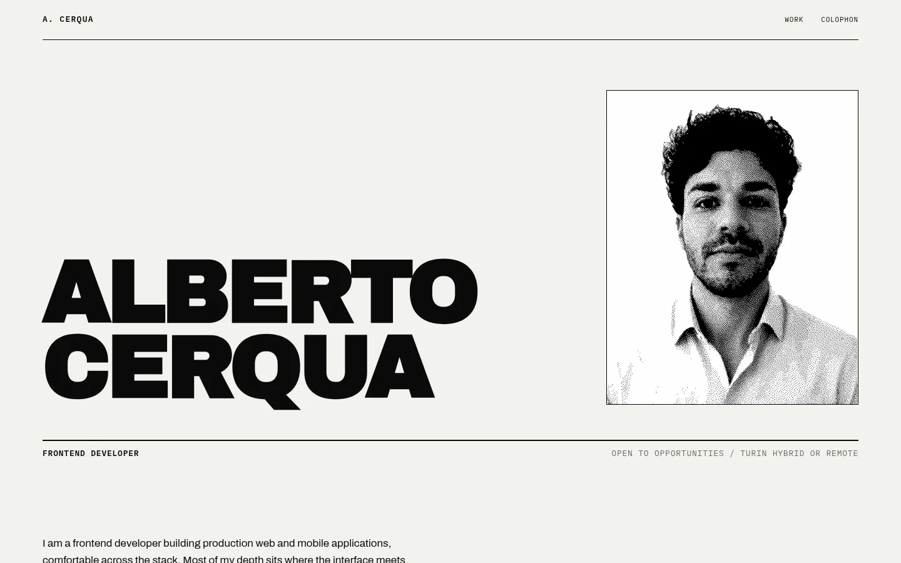

# Portfolio

Personal site of Alberto Cerqua: case studies from client work, written as short technical documents. Live at https://imalbi.pages.dev.



## Stack

- SvelteKit 2 and Svelte 5 with `adapter-static`. Every route is prerendered and `csr` is off, so the site ships no JavaScript.
- Hand-written CSS with custom properties for the tokens. No CSS framework.
- Archivo, Archivo Black and IBM Plex Mono, self-hosted as latin woff2 subsets.
- Hosted on Cloudflare Pages.

Case study copy lives in the route components and `src/lib/content/work.ts`. The architecture diagrams are hand-authored SVG.

## Commands

Needs Node 22.12 or newer.

```sh
npm install
npm run dev       # dev server
npm run build     # static build into build/
npm run preview   # serve the build
npm run check     # svelte-check
npm test          # build, then vitest against the output
npm run deploy    # build and publish to the `imalbi` Pages project (needs a wrangler login)
```

## Tests

`npm test` builds the site and checks the output: every route is prerendered, no JavaScript reaches the browser, and no external font host is referenced. It also scans the source for the copy rules and for unresolved content markers.

## Layout

```
src/routes       pages
src/lib          components, diagrams, content
static           fonts, CV, images, 404 page
tests            vitest
docs/reference   the design mockup and the font files it was built from
```

## License

Copyright 2026 Alberto Cerqua. All rights reserved. The source is public so it can be read, not reused or redistributed.

The fonts are separate works under the SIL Open Font License 1.1. Their notices are in `static/fonts/OFL.txt`.
